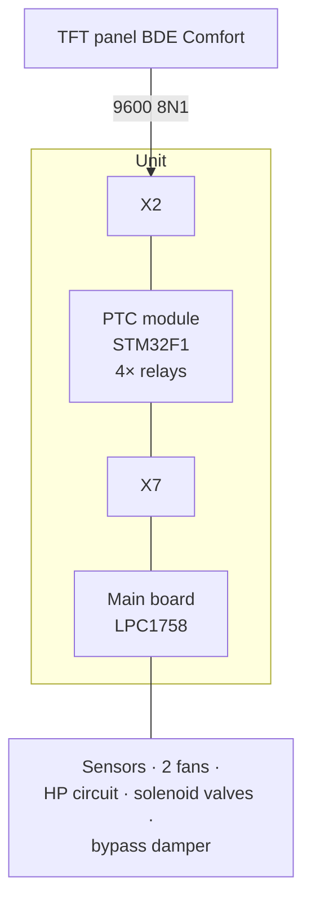

# Unit & architecture

## The unit

**PROXON P 2H-L** (Zimmermann Lüftungs- und Wärmesysteme, "P series" range): a central
comfort ventilation unit with an integrated **counter-flow heat exchanger** and a
frequency-modulated **air-to-air heat pump**. It is operated from a capacitive TFT panel
that identifies itself as **"BDE Comfort"** in its system information.

The unit can heat, (optionally) cool and ventilate, and it has a **controlled summer
bypass** (a standard component of the central unit, not an accessory) as well as
**PTC ceramic heating elements** seated in the supply-air outlets for reheating on
demand.

## Two-board architecture

Two boards work together inside the unit:

| Board | Core device | Role |
|---|---|---|
| **Main board** | NXP **LPC1758** (Cortex-M3) | control, sensors, fans, heat pump, relays |
| **PTC module 4×** | **STM32F1** + 4 power relays | switches the PTC heating elements; couples the two buses |

The control panel talks to the PTC module at **9600 baud** (over a Cat7 connection named
**X2**). The PTC module in turn is connected to the main board through connector **X7** —
and that is where the actual control bus, **HESP at 19200 baud**, runs.



The STM32 on the PTC module is therefore the **active node between the 9600 baud panel
side and the 19200 baud HESP side** — there is no other path between the two domains.

!!! note "The relevant bus level"
    Read and control access happen at the **X7 / 19200 baud** (HESP) level. The 9600 baud
    panel bus is not suitable for this (see
    [Constraints & open points](offene-punkte.md#the-9600-baud-panel-bus)).

## Connector X7

X7 is a 4-pole connector. Pinout (determined with a multimeter and a logic analyser):

| Pin | Signal |
|---|---|
| X7-1 | GND |
| X7-2 | +12 V (VCC) |
| X7-3 | Data B− |
| X7-4 | Data A+ |

An off-the-shelf **USB-RS485 adapter** (in this investigation one with an SP485EEN
transceiver, 19200 8N1) is connected as follows:

```
Adapter A+  →  X7-4
Adapter B-  →  X7-3
Adapter GND →  X7-1
```

A permanently fitted 120 Ω termination on the adapter did not affect the running
communication in this investigation. The bus could be read passively and written to
actively during normal operation without disturbing the regular communication
(STM32 master ↔ LPC1758).

## What is NOT on X7

- The **T300 domestic hot water heat pump** has its own controller and works entirely
  independently — it is not attached to the HESP bus.
- A **device reboot** is not triggered over X7 (no command frame was found).
- A **ground heat exchanger** is not fitted to this unit (fresh air comes through a core
  drilling); the optional "T before GHE" sensor is absent accordingly.
