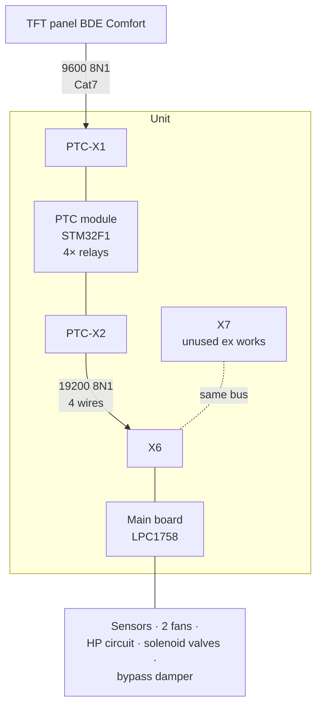
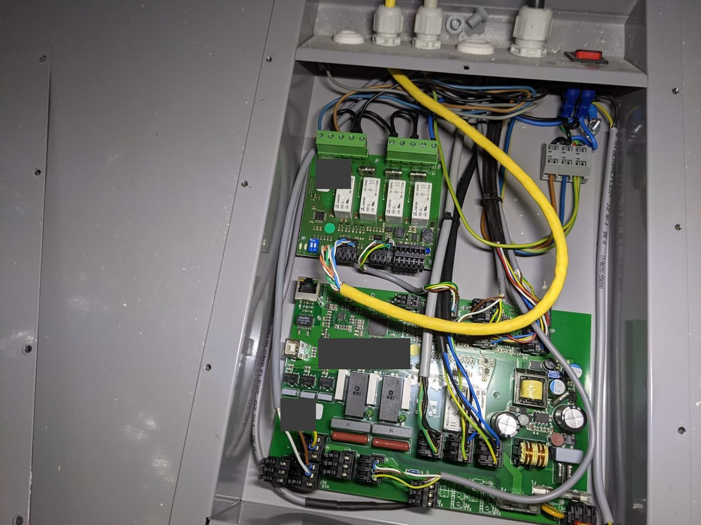
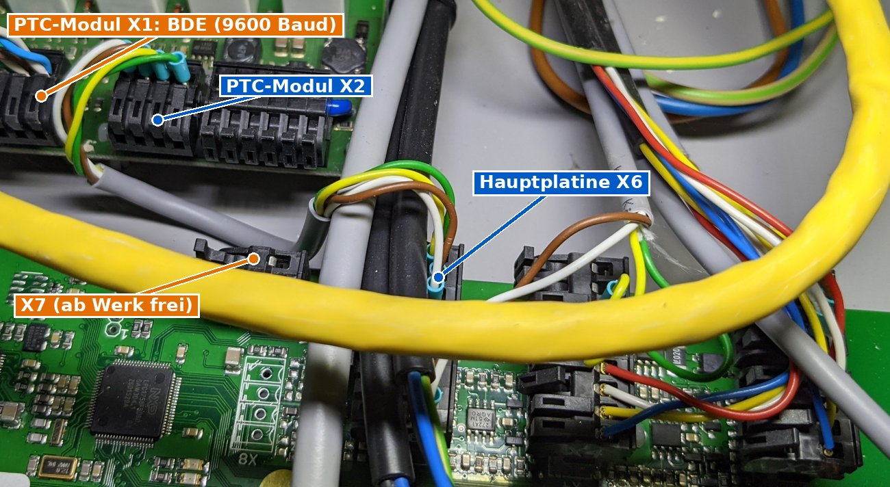
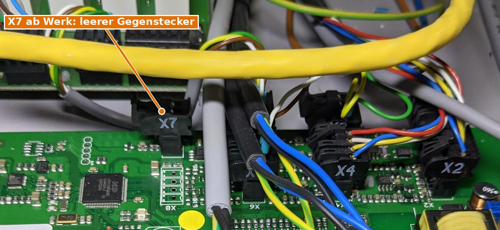

# Unit & architecture

## The unit

**PROXON P 2H-L** (Zimmermann Lüftungs- und Wärmesysteme, "P series" range): a central
comfort ventilation unit with an integrated **counter-flow heat exchanger** and a
frequency-modulated **air-to-air heat pump**. It is operated from a capacitive TFT panel
that identifies itself as **"BDE Comfort"** in its system information.

The unit can heat, (optionally) cool and ventilate, and it has a **controlled summer
bypass** (a standard component of the central unit, not an accessory) as well as
**PTC ceramic heating elements** seated in the supply-air outlets for reheating on
demand.

## Two-board architecture

Two boards work together inside the unit:

| Board | Core device | Role |
|---|---|---|
| **Main board** | NXP **LPC1758** (Cortex-M3) | control, sensors, fans, heat pump, relays |
| **PTC module 4×** | **STM32F1** + 4 power relays | switches the PTC heating elements; couples the two buses |

The control panel is connected over a Cat7 cable at **9600 baud** to connector **X1 of the
PTC module**. From connector **X2 of the PTC module** a four-wire cable runs to the connector
tower **X6 on the main board**. That link carries the actual control bus, **HESP at
19200 baud**.

Next to X6 the main board has the small connector **X7**. It is unused from the factory
(on the unit studied it only held an empty mating plug), but it carries the same HESP bus.
That is where the RS485 adapter was connected for this investigation.



!!! note "Earlier version"
    An earlier version of this page called the panel connector "X2" and described X7 as the
    link between the PTC module and the main board. That was wrong. The assignment above is
    based on photos of the unit taken before the adapter was connected (see
    [Photos](#photos)); a second unit with an LT-ZIM V1.6 main board and a PTC module 4× V1.2
    is wired the same way.

The STM32 on the PTC module is therefore the **active node between the 9600 baud panel
side and the 19200 baud HESP side**. No other path between the two sides is known.

!!! note "The relevant bus level"
    Read and control access happen at the **X7 / 19200 baud** (HESP) level. The 9600 baud
    panel bus is not suitable for this (see
    [Constraints & open points](offene-punkte.md#the-9600-baud-panel-bus)).

## Connector X7

X7 is a small connector right next to an RS485 transceiver on the main board. From above the
mating plug looks two-pole; on the unit studied four positions were usable. Pinout
(determined with a multimeter and a logic analyser):

| Pin | Signal | Status |
|---|---|---|
| X7-1 | GND | measured |
| X7-2 | +12 V (VCC) | assumed, not measured |
| X7-3 | Data B− | measured |
| X7-4 | Data A+ | measured |

The numbers 1 to 4 are the numbering used in this investigation, not a board marking. The
available photos do not show unambiguously where pin 1 is.

!!! warning "Measure before connecting"
    The bus also carries the 12 V supply. Do not copy the pinout by connector number or wire
    colour; determine it on your own unit:

    1. Powered off: find GND by continuity against a known ground point.
    2. Powered on: find the wire with 12 V against GND; between A and B about +2.5 V
       (A against B) were measured here at idle.
    3. Connect the adapter passively first and listen at 19200 8N1. Only when frames with a
       valid [checksum](protokoll.md#checksum) arrive is the assignment certain.

    The link PTC-X2 to X6 carries the same bus. Its pinout was not measured in this
    investigation.

An off-the-shelf **USB-RS485 adapter** (in this investigation one with an SP485EEN
transceiver, 19200 8N1) is connected as follows:

```
Adapter A+  →  X7-4
Adapter B-  →  X7-3
Adapter GND →  X7-1
```

A permanently fitted 120 Ω termination on the adapter did not affect the running
communication in this investigation. The bus could be read passively and written to
actively during normal operation without disturbing the regular communication
(STM32 master ↔ LPC1758).

## Operation without the control panel

On the unit studied, the control panel has been unplugged since July 2026. Since then a
separate sender on X7 has permanently taken over the role of the master. The following
points are observations from this operation.

- **Without the panel the HESP bus is silent.** The PTC module then sends no telegrams of
  its own. A device that only listens receives nothing without the panel; this matches the
  observation on a second unit.
- **The main board still answers.** QUERY and SET telegrams to node 2 are answered or
  acknowledged directly without the panel.
- **The state has to be sent cyclically.** The set that the panel writes about every
  5 seconds was reproduced, in the panel's order: operating mode `0x020a`, fan stage
  `0x00e1`, room temperature `0x0226`, room setpoint `0x0227`, followed by the values the
  panel always sends unchanged, `0x0229` and `0x022a` (21.0 each) and `0x022c`, `0x03b6`
  and `0x01f8` (0 each). Without this set the main board fell back to the fallback state
  (see below). Every SET is acknowledged with a CONFIRM.
- **Fallback state:** If the master's telegrams stop, the unit keeps ventilating with
  fixed fan speeds after a while (observed roughly stage 3), and `0x020a` then reads 6.
  When the master sends again, the main board adopts the state it sends. How long it takes
  until the fallback has not been measured.
- **Never two masters at once.** When the panel and a separate sender were active at the
  same time, requests and responses overlapped. Responses could then no longer be
  attributed reliably to one's own request, and readings without physical meaning
  appeared. For checks with the panel the separate sender was therefore silenced
  completely beforehand.
- **What nobody takes care of without the panel:** nobody sets the device clock `0x032e`;
  it keeps running, but on the unit studied it had never been set and was set once via
  SET. Time programmes are lost (see
  [Constraints](offene-punkte.md#further-constraints-of-the-unit)). The filter countdown
  `0x00ed`, on the other hand, keeps counting in the main board.

## What is NOT on X7

- The **T300 domestic hot water heat pump** has its own controller and works entirely
  independently — it is not attached to the HESP bus.
- A **device reboot** is not triggered over X7 (no command frame was found).
- A **ground heat exchanger** is not fitted to this unit (fresh air comes through a core
  drilling); the optional "T before GHE" sensor is absent accordingly.

## Photos

The photos are from 2021, before the adapter was connected. Serial numbers and the MAC
address are blacked out. The labels in the pictures are in German.






