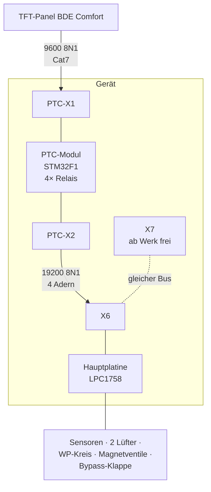
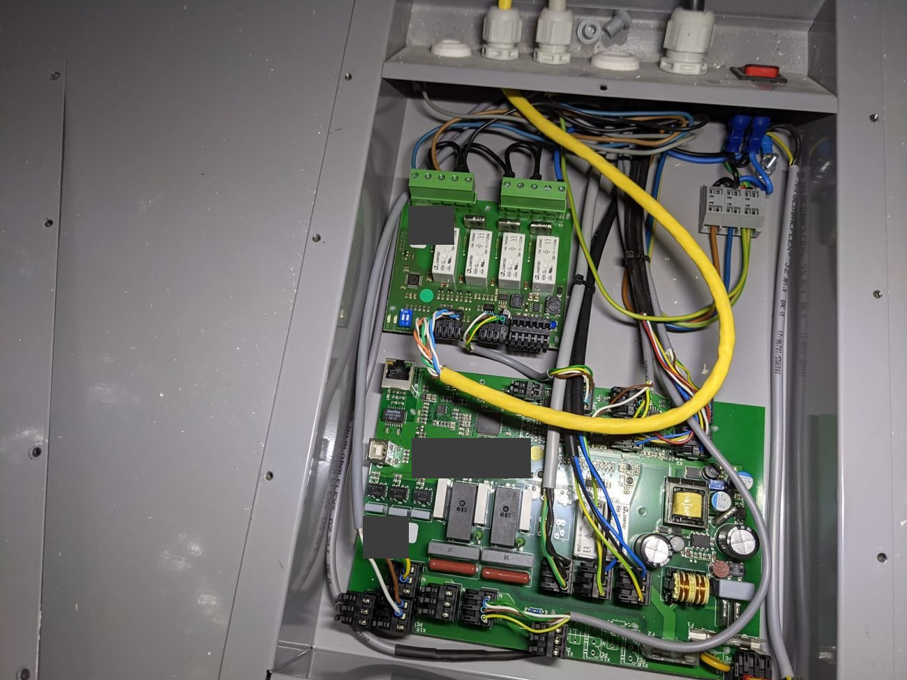
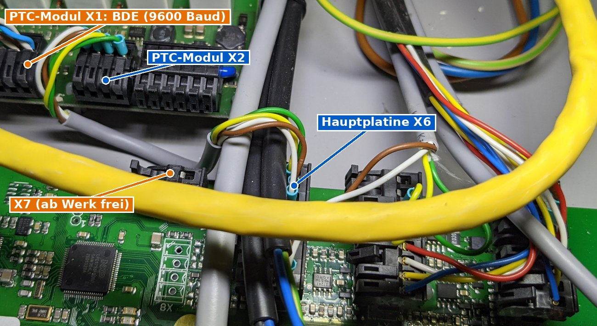
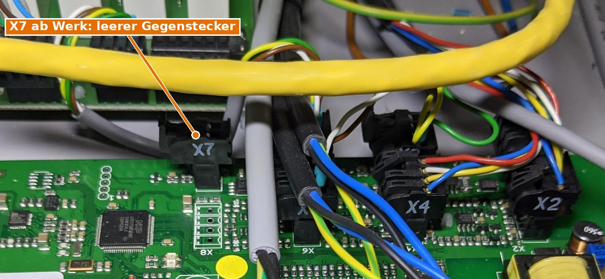

# Anlage & Architektur

## Das Gerät

**PROXON P 2H-L** (Zimmermann Lüftungs- und Wärmesysteme, Baureihe „P-Serie"): eine
zentrale Komfortlüftung mit integriertem **Kreuzgegenstrom-Wärmetauscher** und
frequenzmodulierter **Luft-Luft-Wärmepumpe**. Bedient wird sie über ein kapazitives
TFT-Panel, das sich in den Systeminformationen selbst als **„BDE Comfort"** ausweist.

Die Anlage kann heizen, (optional) kühlen, lüften und verfügt über einen **geregelten
Sommerbypass** (Standardkomponente des Zentralgeräts, kein Zubehör) sowie in den
Zuluftauslässen sitzende **PTC-Keramik-Wärmeelemente** zur bedarfsweisen Nacherwärmung.

## Zwei-Platinen-Architektur

Im Gerät arbeiten zwei Platinen zusammen:

| Platine | Kernbaustein | Rolle |
|---|---|---|
| **Hauptplatine** | NXP **LPC1758** (Cortex-M3) | Regelung, Sensorik, Lüfter, Wärmepumpe, Relais |
| **PTC-Modul 4×** | **STM32F1** + 4 Leistungsrelais | schaltet die PTC-Heizregister; koppelt die zwei Busse |

Das Bedienpanel ist über ein Cat7-Kabel mit **9600 Baud** am Stecker **X1 des
PTC-Moduls** angeschlossen. Vom Stecker **X2 des PTC-Moduls** führt ein vieradriges Kabel zum
Steckerturm **X6 der Hauptplatine**. Auf dieser Verbindung läuft der eigentliche Steuerbus,
**HESP mit 19200 Baud**.

Neben X6 sitzt auf der Hauptplatine der kleine Stecker **X7**. Er ist ab Werk nicht belegt
(bei der untersuchten Anlage steckte dort nur ein leerer Gegenstecker), führt aber denselben
HESP-Bus. Dort wurde für diese Untersuchung der RS485-Adapter angeschlossen.



!!! note "Frühere Fassung"
    Eine frühere Fassung dieser Seite nannte den Panel-Anschluss „X2“ und beschrieb X7 als
    Verbindung zwischen PTC-Modul und Hauptplatine. Das war falsch. Die Zuordnung oben folgt
    Fotos der untersuchten Anlage aus der Zeit vor dem Anschluss des Adapters (siehe
    [Fotos](#fotos)); eine zweite Anlage mit Hauptplatine LT-ZIM V1.6 und PTC-Modul 4× V1.2
    ist genauso verkabelt.

Der STM32 auf dem PTC-Modul ist damit der **aktive Knoten zwischen der 9600er
Panel-Seite und der 19200er HESP-Seite**. Ein anderer Pfad zwischen den beiden Seiten ist
nicht bekannt.

!!! note "Relevante Bus-Ebene"
    Auslese- und Steuerzugriff erfolgen auf der Ebene **X7 / 19200 Baud** (HESP). Der
    9600-Baud-Panel-Bus eignet sich dafür nicht (siehe
    [Randbedingungen & offene Punkte](offene-punkte.md#der-9600-baud-panel-bus)).

## Anschluss X7

X7 ist ein kleiner Steckverbinder direkt neben einem RS485-Transceiver der Hauptplatine. Von
oben sieht der Gegenstecker zweipolig aus; bei der untersuchten Anlage waren dort vier
Positionen nutzbar. Belegung (per Multimeter und Logic-Analyzer ermittelt):

| Pin | Signal | Stand |
|---|---|---|
| X7-1 | GND | gemessen |
| X7-2 | +12 V (VCC) | vermutet, nicht gemessen |
| X7-3 | Data B− | gemessen |
| X7-4 | Data A+ | gemessen |

Die Nummern 1 bis 4 sind die Zählung dieser Untersuchung, kein Platinenaufdruck. Wo Pin 1
liegt, zeigen die vorhandenen Fotos nicht eindeutig.

!!! warning "Vor dem Anschließen selbst messen"
    Am Bus liegt auch die 12-V-Versorgung. Die Belegung daher nicht nach Steckernummer oder
    Aderfarbe übernehmen, sondern an der eigenen Anlage bestimmen:

    1. Stromlos: GND per Durchgangsprüfung gegen einen bekannten Massepunkt suchen.
    2. Unter Spannung: die Ader mit 12 V gegen GND finden; zwischen A und B lagen hier im
       Ruhezustand etwa +2,5 V (A gegen B).
    3. Den Adapter zuerst nur passiv anschließen und bei 19200 8N1 mitlesen. Erst wenn
       Frames mit gültiger [Prüfsumme](protokoll.md#prufsumme) ankommen, ist die
       Zuordnung sicher.

    Die Verbindung PTC-X2 zu X6 führt denselben Bus. Ihre Belegung wurde in dieser
    Untersuchung nicht gemessen.

Ein handelsüblicher **USB-RS485-Adapter** (in dieser Untersuchung ein Adapter mit
SP485EEN-Transceiver, 19200 8N1) wird wie folgt angeklemmt:

```
Adapter A+  →  X7-4
Adapter B-  →  X7-3
Adapter GND →  X7-1
```

Eine fest verbaute 120-Ω-Terminierung des Adapters beeinflusste die laufende
Kommunikation in dieser Untersuchung nicht. Der Bus konnte im laufenden Betrieb passiv
mitgelesen und aktiv beschrieben werden, ohne die reguläre Kommunikation
(STM32-Master ↔ LPC1758) zu stören.

## Was NICHT auf X7 liegt

- Die **Trinkwasser-Wärmepumpe T300** hat einen eigenen Regler und arbeitet vollständig
  eigenständig — sie hängt nicht am HESP-Bus.
- Der **Geräte-Reboot** wird nicht über X7 ausgelöst (kein Kommando-Frame gefunden).
- Ein **Erdwärmetauscher** ist bei dieser Anlage nicht verbaut (Frischluft kommt über
  eine Kernlochbohrung); der optionale Fühler „T vor EWT" fehlt entsprechend.

## Fotos

Die Fotos stammen von 2021, also aus der Zeit vor dem Anschluss des Adapters.
Seriennummern und MAC-Adresse sind geschwärzt.






